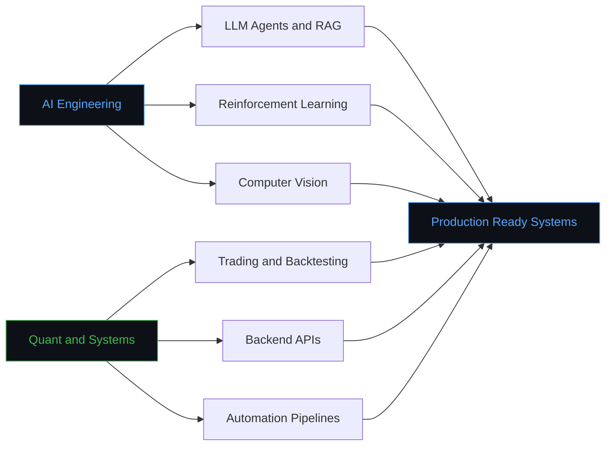
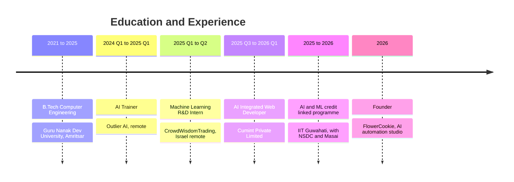

<p align="center">
  
</p>

<p align="center">
  
  &nbsp;
  <a href="https://linkedin.com/in/maahin-bir-singh-osahan"></a>
  &nbsp;
  <a href="mailto:maahinosahan123@gmail.com"></a>
  &nbsp;
  
</p>


<br>

```python
class MaahinOsahan:
    def __init__(self):
        self.name = "Maahin Bir Singh Osahan"
        self.role = ["ML and AI Engineer", "Founder at FlowerCookie"]
        self.education = "B.Tech Computer Engineering, Guru Nanak Dev University, Amritsar"
        self.certification = "AI and ML credit linked programme, IIT Guwahati (NSDC and Masai)"

    def focus(self):
        return {
            "agents": ["LangChain", "LangGraph", "Google ADK", "RAG Pipelines", "MCP"],
            "ml_rl": ["PyTorch", "TensorFlow", "scikit learn", "Q Learning", "DQN", "YOLOv5"],
            "quant": ["yfinance", "backtesting", "walk forward validation", "Sharpe and Sortino"],
            "backend": ["FastAPI", "Flask", "PostgreSQL", "MongoDB", "Redis", "Supabase"],
        }

me = MaahinOsahan()
```

## About me

B.Tech in Computer Engineering from Guru Nanak Dev University, Amritsar, and an AI and ML credit linked programme from IIT Guwahati, run with NSDC and Masai. I write code that ends up in production, LLM agents, trading systems, RAG pipelines and automation workflows, not just experiments.

I have worked as a Machine Learning R&D Intern at CrowdWisdomTrading, building XGBoost and Random Forest pipelines for trading session research with full backtesting and walk forward validation. I later worked as an AI Integrated Web Developer at Cumint Private Limited, shipping Flask and MongoDB backends with OpenAI and Hugging Face integrations, REST APIs, dashboards and CI/CD. Before that I trained and evaluated models at Outlier AI, working across mathematical, coding and NLP tasks.

I now run FlowerCookie, a small studio that fine tunes and trains models around each client's own data and requirements, builds AI based product commercials, and ships plug and play software with AI baked directly into the system, including ERP modules and CRM tools.

I am looking for full time, remote or freelance roles where I can work on hard ML problems with people who actually care about shipping.

<br>

## Tech stack

<p align="center">
  
</p>

<br>

**LLM and GenAI**: LangChain, LangGraph, Google ADK, OpenAI API, HuggingFace, FAISS, RAG Pipelines, Prompt Engineering, DeepSeek, Groq

**ML, RL and DL**: PyTorch, TensorFlow, scikit learn, XGBoost, LightGBM, Q Learning, DQN, Whisper, YOLOv5, CLIP

**Quant and Finance**: yfinance, backtesting, Sharpe and Sortino ratios, walk forward validation, AngelOne API

**Backend**: FastAPI, Flask, PostgreSQL, MongoDB, Redis, Supabase, Socket.IO, REST APIs, Celery

**Automation**: n8n, GitHub Actions, LangChain Agents, Tool Chaining, MCP, Webhooks

**DevOps**: Docker, Kubernetes, Heroku, Helm, CI/CD, Linux

**Frontend**: React, Streamlit, TypeScript, JavaScript, HTML and CSS

**Data**: Pandas, NumPy, Matplotlib, Seaborn, YAML, JSON

<br>

## Focus areas



<br>

## Experience



<br>

## Featured projects

**Multi Agent AI Fund Manager**

An open source AI fund manager and stock research terminal for the Indian stock market. Multi agent LLM analysts debate and a judge agent scores the result, with XBRL fundamentals, DCF valuation ranges, a live options chain with Greeks, charts and a screener.

Tech: Rust, TypeScript, Python, DuckDB

See [github.com/maahin-1/athena-the-fund-manager](https://github.com/maahin-1/athena-the-fund-manager)

<br>

**Reinforcement Learning Trading Bot**

Trades AAPL, MSFT, GOOGL and SPY at the same time using a Q Learning agent that can go long, short, hold or close on each independently. Built on an 11 feature state vector, RSI, MACD, Bollinger Bands, ATR, unrealised PnL, tested with 4 fold walk forward validation and full transaction cost modelling.

Tech: Python, Q Learning, DQN, yfinance, NumPy, Pandas

See [github.com/maahin-1/Reinforcement-Learning-Trading-Bot](https://github.com/maahin-1/Reinforcement-Learning-Trading-Bot)

<br>

**Portfolio Efficient Frontier and GBM Simulator**

Markowitz Efficient Frontier with Geometric Brownian Motion path simulation. Shows the real risk return curve across a multi asset portfolio, with a limit order book simulator included.

Tech: Python, NumPy, Matplotlib, Seaborn, SciPy

See [github.com/maahin-1/Portfolio-Efficient-Frontier](https://github.com/maahin-1/Portfolio-Efficient-Frontier)

<br>

**IPL Predictive Intelligence Engine**

A three layer ML ensemble that predicts IPL match winners, season champions and playoff spots in real time. Four base models feed into an XGBoost meta learner, which hands calibrated probabilities to an LLM that writes match narratives, confidence tags and fantasy captain picks.

Tech: Python, XGBoost, LightGBM, FastAPI, Kafka, Redis, Claude API, MLflow

See [github.com/maahin-1/IPL-Winner-Predictor](https://github.com/maahin-1/IPL-Winner-Predictor)

<br>

**Real Time Face Recognition System**

Live webcam face recognition using OpenCV's LBPH recognizer. Processes labeled face images to train a custom model, then runs in real time detecting faces, eyes and smiles with identity labels on every frame.

Tech: Python, OpenCV, LBPH, NumPy, Pillow

See [github.com/maahin-1/Face-Recognition](https://github.com/maahin-1/Face-Recognition)

<br>

## Currently building

**FlowerCookie, AI Automation Studio**

Automation pipelines for businesses that are tired of doing the same thing manually. WhatsApp agents with memory, routing logic and live Google Sheets knowledge bases.

Fine tuning and training models around each client's own data and workflows instead of shipping one generic model to everyone. Producing AI based product commercials and marketing visuals for client brands. Building plug and play software with AI systems built directly into it, including ERP modules and CRM tools that run on the client's own infrastructure.

Working with EdTech clients right now.

<br>

## Open to collaboration

<table width="100%">
<tr>
<td align="center" width="20%">
  <picture>
    <source media="(prefers-color-scheme: dark)" srcset="https://api.iconify.design/mdi/robot-outline.svg?color=white">
    <source media="(prefers-color-scheme: light)" srcset="https://api.iconify.design/mdi/robot-outline.svg?color=black">
    
  </picture>
  <br><br>
  <strong>LLM Agents</strong>
  <br><br>
  <small>
    Agent Architectures<br>
    RAG Pipelines<br>
    Tool Use and MCP
  </small>
</td>
<td align="center" width="20%">
  <picture>
    <source media="(prefers-color-scheme: dark)" srcset="https://api.iconify.design/mdi/chart-line.svg?color=white">
    <source media="(prefers-color-scheme: light)" srcset="https://api.iconify.design/mdi/chart-line.svg?color=black">
    
  </picture>
  <br><br>
  <strong>Quant and Trading</strong>
  <br><br>
  <small>
    Backtesting<br>
    Risk and Portfolio Tools<br>
    Signal Research
  </small>
</td>
<td align="center" width="20%">
  <picture>
    <source media="(prefers-color-scheme: dark)" srcset="https://api.iconify.design/mdi/eye-outline.svg?color=white">
    <source media="(prefers-color-scheme: light)" srcset="https://api.iconify.design/mdi/eye-outline.svg?color=black">
    
  </picture>
  <br><br>
  <strong>Computer Vision</strong>
  <br><br>
  <small>
    Detection and Recognition<br>
    Pose Estimation<br>
    Model Comparison Studies
  </small>
</td>
<td align="center" width="20%">
  <picture>
    <source media="(prefers-color-scheme: dark)" srcset="https://api.iconify.design/mdi/cog-sync-outline.svg?color=white">
    <source media="(prefers-color-scheme: light)" srcset="https://api.iconify.design/mdi/cog-sync-outline.svg?color=black">
    
  </picture>
  <br><br>
  <strong>Automation and Backend</strong>
  <br><br>
  <small>
    FastAPI Services<br>
    Workflow Automation<br>
    CI and CD
  </small>
</td>
<td align="center" width="20%">
  <picture>
    <source media="(prefers-color-scheme: dark)" srcset="https://api.iconify.design/mdi/open-source-initiative.svg?color=white">
    <source media="(prefers-color-scheme: light)" srcset="https://api.iconify.design/mdi/open-source-initiative.svg?color=black">
    
  </picture>
  <br><br>
  <strong>Open Source</strong>
  <br><br>
  <small>
    Real Tests and Fixes<br>
    Honest Documentation<br>
    Community Projects
  </small>
</td>
</tr>
</table>

<br>

## GitHub stats

<p align="center">
  
  
</p>

<p align="center">
  
</p>

<br>

<p align="center">
  
</p>

<p align="center">
  
  &nbsp;
  
</p>

<br>

## Trophies

<p align="center">
  
</p>

<br>

## Activity


<br>

## Contribution snake


<br>

## Let's connect

Got a role, a project or something you are building, I am easy to reach.

Email: [maahinosahan123@gmail.com](mailto:maahinosahan123@gmail.com)
LinkedIn: [linkedin.com/in/maahin-bir-singh-osahan](https://linkedin.com/in/maahin-bir-singh-osahan)

<p align="center">
  <i>"Play long term games with long term people. All returns in life, whether in wealth, relationships or knowledge, come from compound interest."</i>
  <br><br>
  <b>Naval Ravikant</b>
</p>


